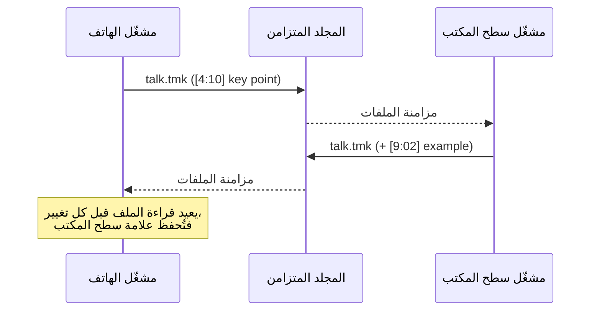

# العلامات المرجعية (ملفات `.tmk`)

أثناء الاستماع إلى محاضرة أو حديث أو مذكرة صوتية، كثيرًا ما تريد أن تقول *"هذا الجزء — عُد
إلى هنا"*. يخزّن نبراس هذه العلامات في **ملف `.tmk` نصي صغير بجانب الوسائط**. يقرأ
[الهاتف](../mobile/index.md) و[مشغّل الصوت على سطح المكتب](../audio-player/index.md) الملفات نفسها ويكتبان فيها،
فتظهر العلامة المضافة على أحدهما في الآخر بمجرد مزامنة المجلد.

## الصيغة { #the-format }

علامة مرجعية واحدة في كل سطر: طابع زمني بين قوسين مربعين، يتبعه اختياريًا وصف.

```text
[0:43]
[12:04] key definition
[25:10] auto
[1:03:20] p2 summary of the argument
```

| الجزء | القاعدة |
|------|------|
| الطابع الزمني | `m:ss` لما دون الساعة، و`h:mm:ss` ابتداءً من الساعة — ثوانٍ كاملة، بأرقام لاتينية. |
| الوصف | كل ما يأتي بعد `]`. اختياري. يُحفظ كما كُتب تمامًا. |
| الترتيب | يُرتَّب حسب الوقت عند الحفظ. |
| الترميز | UTF-8، فيمكن أن تكون الأوصاف بأي لغة. |

بعض الأوصاف تكتبها التطبيقات نفسها:

- `auto` — يستطيع الهاتف إضافة علامة مرجعية **تلقائيًا في كل مرة توقف فيها التشغيل مؤقتًا** (من الشاشة، أو من
  زر السماعة، أو حين يوقف مؤقّت النوم التشغيل). وإن كانت للوسائط ترجمة نصية، يُستخدم
  سطر الترجمة في تلك اللحظة وصفًا بدلًا من `auto`.
- الحرف `p` متبوعًا برقم في البداية (مثل `p2`) هو رمز أولوية؛ ويتركه كلا التطبيقين كما هو.

يضع كلا المشغّلين العلامة الجديدة **قبل بضع ثوانٍ** من لحظة ضغطك الزر (ومقدار
الرجوع إعداد قابل للتغيير)، فتقع العلامة على ما سمعته للتو، لا بعده.

## تسمية الملف المرافق { #sidecar-naming }

لملف `.tmk` **الاسم الأساسي نفسه لملف الوسائط**، مع استبدال الامتداد:

```text
lecture-03.mp3   →   lecture-03.tmk
interview.mp4    →   interview.tmk
```

ولأن الامتداد وحده يتغيّر، فإن `talk.mp3` و`talk.m4a` في المجلد نفسه سيتشاركان ملفًا واحدًا
`talk.tmk` — فامنح التسجيلات المختلفة أسماء مختلفة.

!!! note "الملفات المرافقة القديمة"
    كانت إصدارات الهاتف القديمة تكتب العلامات المرجعية في ملف `.txt` بالاسم الأساسي نفسه. وما زال الهاتف
    يقرؤه، وينتقل إلى `.tmk` في المرة التالية التي يحفظ فيها.

## ملفات أجهزة التسجيل الصوتي (صيغة Sony ICD) { #voice-recorder-files-sony-icd-format }

بعض أجهزة التسجيل الصوتي المخصّصة (مثل سلسلة ICD من Sony) تكتب ملفات `.tmk` خاصة بها، بدقائق
طويلة مبطّنة بالأصفار، وأجزاء من مئة من الثانية، وعلامة ترتيب بايتات غير مرئية في البداية:

```text
[00004:58.00]
[00012:31.50]
```

يقرأ **الهاتف** هذه كعلامات مرجعية عادية (4:58، 12:31…). وعند الحفظ، أي سطر لا
يفهمه **يُحتفظ به** أسفل العلامات بدلًا من رميه، فلا يتقلّص ملف آتٍ من أداة أخرى
أبدًا بسبب تعديل.

!!! warning "مشغّل سطح المكتب وملفات أجهزة التسجيل"
    يقرأ مشغّل سطح المكتب الطوابع الزمنية بين الأقواس في مثل هذه الملفات، لكنه قد يُفلت السطر
    الأول تحديدًا (الذي يحمل علامة ترتيب البايتات)، وعند الحفظ يعيد كتابة الملف بالعلامات التي
    فهمها فقط. أضف علاماتك المرجعية الأولى إلى ملفات أجهزة التسجيل على الهاتف.

## كيف يتشاركها الهاتف وسطح المكتب { #how-the-phone-and-desktop-share-them }



- يكتب كلا التطبيقين الصيغة نفسها تمامًا، فيمكن لأيٍّ منهما أن يكون آخر من يكتب.
- **يعيد الهاتف قراءة الملف من القرص قبل كل تغيير** (إضافة علامة أو تعديلها أو حذفها،
  بما في ذلك العلامات التلقائية)، فلا تُكتب فوق العلامات التي وصلت من سطح المكتب في الأثناء
  نسخةٌ أقدم محفوظة في الذاكرة.
- يعرض سطح المكتب العلامات المرجعية كشَرطات على شريط التنقّل الموجي وكقائمة قابلة للتحرير، ويعدّها
  عمود **Bkm** (العلامات) في قائمة التشغيل لكل ملف.
- في knotes لسطح المكتب، الملاحظة التي يحوي [مجلدها المرافق](companion-folders.md) وسائط لها ملفات `.tmk`
  تعرض عدّاد **time marks** (علامات زمنية) على بطاقتها.

## أبقِ ملف `.tmk` مع وسائطه { #keep-the-tmk-with-its-media }

يرتبط ملف العلامات المرجعية بوسائطه **بالاسم والموقع فقط**. لا شيء آخر يسجّل أي
العلامات تخص أي ملف. لذلك:

- **انقلهما أو انسخهما معًا.** نقل `lecture.mp3` إلى مجلد آخر دون `lecture.tmk`
  يترك العلامات المرجعية خلفه؛ ويبدأ الملف المنقول بلا علامات.
- **أعِد تسميتهما معًا.** إعادة تسمية `lecture.mp3` إلى `lecture-final.mp3` تجعل `lecture.tmk` يتيمًا.
  أعِد تسمية ملف `.tmk` إلى `lecture-final.tmk` أيضًا.
- **ضع العلامات على النسخة التي تحتفظ بها.** العلامات المضافة أثناء تشغيل نسخة مؤقتة (مرآة استماع، أو
  مجلد تنزيلات) تُحفظ بجانب *تلك* النسخة. أعِد ملف `.tmk` إلى مكانه، أو شغّل الأصل.
- **الحذف من المشغّلين يأخذ العلامات المرجعية معه.** ينقل مشغّل سطح المكتب كلا الملفين إلى
  سلة المهملات؛ ويخبرك الهاتف بعدد العلامات التي ستذهب مع الملف قبل الحذف.

!!! tip "تلميح"
    لأن ملف `.tmk` نص عادي، يمكن استعادة المفقود منه من أي نسخة احتياطية أو من سجل إصدارات
    أداة المزامنة، ثم وضعه ببساطة من جديد بجانب الوسائط.
