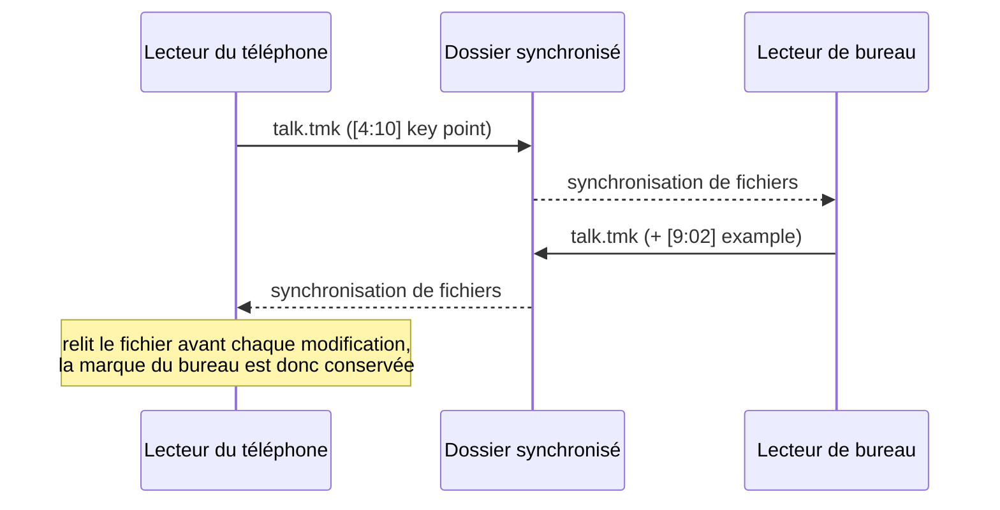

# Signets (fichiers `.tmk`)

En écoutant un cours, une conférence ou un mémo vocal, on a souvent envie de dire *« ce passage — reviens
ici »*. Nibras enregistre ces marques dans un petit **fichier texte brut `.tmk` placé à côté du média**. Le
[téléphone](../mobile/index.md) et le [lecteur audio de bureau](../audio-player/index.md) lisent et écrivent
les mêmes fichiers ; une marque posée sur l'un apparaît donc sur l'autre une fois le dossier synchronisé.

## Le format { #the-format }

Un signet par ligne : un horodatage entre crochets, éventuellement suivi d'un libellé.

```text
[0:43]
[12:04] key definition
[25:10] auto
[1:03:20] p2 summary of the argument
```

| Partie | Règle |
|------|------|
| Horodatage | `m:ss` en dessous d'une heure, `h:mm:ss` à partir d'une heure — secondes entières, chiffres latins. |
| Libellé | Tout ce qui suit `]`. Facultatif. Conservé exactement tel qu'écrit. |
| Ordre | Trié par temps à l'enregistrement. |
| Encodage | UTF-8 ; les libellés peuvent donc être dans n'importe quelle langue. |

Certains libellés sont écrits par les applications elles-mêmes :

- `auto` — le téléphone peut poser un signet **automatiquement à chaque pause** (à l'écran, depuis un
  bouton du casque, ou lorsque la minuterie de mise en veille arrête la lecture). Si le média a des sous-titres, la
  ligne de sous-titre à cet instant sert de libellé à la place de `auto`.
- Un `p` initial suivi d'un chiffre (p. ex. `p2`) est un jeton de priorité ; les deux applications le laissent intact.

Les deux lecteurs placent une nouvelle marque **quelques secondes avant** le moment où vous appuyez sur le bouton (le
recul est un paramètre), pour que la marque tombe sur ce que vous venez d'entendre, et non après.

## Nommage du fichier annexe { #sidecar-naming }

Le fichier `.tmk` porte le **même nom de base que le fichier média**, avec l'extension remplacée :

```text
lecture-03.mp3   →   lecture-03.tmk
interview.mp4    →   interview.tmk
```

Comme seule l'extension change, `talk.mp3` et `talk.m4a` dans un même dossier partageraient un seul
`talk.tmk` — donnez des noms différents aux enregistrements différents.

!!! note "Anciens fichiers annexes"
    Les anciennes versions du téléphone écrivaient les signets dans un fichier `.txt` de même nom de base. Le téléphone le
    lit toujours et passe à `.tmk` au prochain enregistrement.

## Fichiers d'enregistreurs vocaux (format Sony ICD) { #voice-recorder-files-sony-icd-format }

Certains enregistreurs vocaux dédiés (par exemple la série ICD de Sony) écrivent leurs propres fichiers `.tmk`, avec
des minutes longues complétées de zéros, des centièmes de seconde et une marque d'ordre d'octets invisible au début :

```text
[00004:58.00]
[00012:31.50]
```

Le **téléphone** les lit comme des signets normaux (4:58, 12:31…). À l'enregistrement, toute ligne qu'il ne
comprend pas est **conservée** sous les marques au lieu d'être jetée ; un fichier provenant d'un autre outil n'est donc
jamais amputé par une modification.

!!! warning "Lecteur de bureau et fichiers d'enregistreurs"
    Le lecteur de bureau lit les horodatages entre crochets de ces fichiers, mais peut manquer la toute première
    ligne (celle qui porte la marque d'ordre d'octets), et à l'enregistrement il réécrit le fichier avec seulement
    les marques qu'il a comprises. Ajoutez vos premiers signets aux fichiers d'enregistreurs sur le téléphone.

## Comment le téléphone et le bureau les partagent { #how-the-phone-and-desktop-share-them }



- Les deux applications écrivent le même format ; l'une ou l'autre peut donc être la dernière à écrire.
- Le téléphone **relit le fichier sur le disque avant chaque modification** (ajout, modification ou suppression d'une
  marque, y compris automatique) ; les marques arrivées entre-temps depuis le bureau ne sont donc pas
  écrasées par une copie plus ancienne gardée en mémoire.
- Le bureau affiche les signets sous forme de repères sur la barre de recherche en forme d'onde et sous forme de liste modifiable, et la
  colonne **Bkm** (signets) de la liste de lecture les compte par fichier.
- Dans knotes pour le bureau, une note dont le [dossier compagnon](companion-folders.md) contient des médias avec des fichiers `.tmk`
  affiche un compteur de **marques temporelles** sur sa carte.

## Gardez le `.tmk` avec son média { #keep-the-tmk-with-its-media }

Un fichier de signets n'est lié à son média **que par son nom et son emplacement**. Rien d'autre n'enregistre quelles
marques appartiennent à quel fichier. Donc :

- **Déplacez-les ou copiez-les ensemble.** Déplacer `lecture.mp3` vers un autre dossier sans `lecture.tmk`
  laisse les signets derrière ; le fichier déplacé repart sans aucun.
- **Renommez-les ensemble.** Renommer `lecture.mp3` en `lecture-final.mp3` rend `lecture.tmk` orphelin.
  Renommez aussi le `.tmk` en `lecture-final.tmk`.
- **Posez vos signets sur la copie que vous gardez.** Les marques posées en lisant une copie temporaire (un miroir d'écoute, un
  dossier de téléchargement) sont enregistrées à côté de *cette* copie. Rapportez le `.tmk` chez lui, ou lisez l'original.
- **Supprimer depuis les lecteurs emporte les signets.** Le lecteur de bureau déplace les deux fichiers dans
  la Corbeille ; le téléphone vous indique combien de marques partiront avec le fichier avant de le supprimer.

!!! tip "Astuce"
    Comme un `.tmk` est du texte brut, un fichier perdu peut être restauré depuis n'importe quelle sauvegarde ou historique des versions d'un outil de
    synchronisation, puis simplement redéposé à côté du média.
