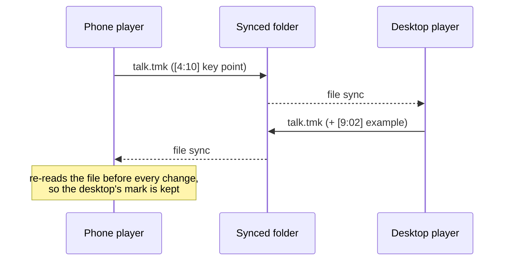

# Bookmarks (`.tmk` files)

While listening to a lecture, a talk or a voice memo you often want to say *"this bit — come back
here"*. Nibras stores those marks in a tiny plain-text **`.tmk` file next to the media**. The
[phone](../mobile/index.md) and the [desktop audio player](../audio-player/index.md) read and write
the same files, so a mark made on one shows up on the other once the folder is synced.

## The format

One bookmark per line: a timestamp in square brackets, optionally followed by a label.

```text
[0:43]
[12:04] key definition
[25:10] auto
[1:03:20] p2 summary of the argument
```

| Part | Rule |
|------|------|
| Timestamp | `m:ss` under an hour, `h:mm:ss` from an hour on — whole seconds, Latin digits. |
| Label | Everything after `]`. Optional. Kept exactly as written. |
| Order | Sorted by time when saved. |
| Encoding | UTF-8, so labels can be in any language. |

Some labels are written by the apps themselves:

- `auto` — the phone can drop a bookmark **automatically every time you pause** (on-screen, from a
  headset button, or when the sleep timer stops playback). If the media has subtitles, the
  subtitle line at that moment is used as the label instead of `auto`.
- A leading `p` + digit (e.g. `p2`) is a priority token; both apps keep it untouched.

Both players place a new mark **a few seconds before** the moment you press the button (the
rewind is a setting), so the mark lands on what you just heard, not after it.

## Sidecar naming

The `.tmk` file has the **same base name as the media file**, with the extension replaced:

```text
lecture-03.mp3   →   lecture-03.tmk
interview.mp4    →   interview.tmk
```

Because only the extension changes, `talk.mp3` and `talk.m4a` in the same folder would share one
`talk.tmk` — give different recordings different names.

!!! note "Older sidecars"
    Older phone versions wrote bookmarks to a `.txt` file with the same base name. The phone still
    reads it and switches to `.tmk` the next time it saves.

## Voice-recorder files (Sony ICD format)

Some dedicated voice recorders (for example Sony's ICD series) write their own `.tmk` files, with
long zero-padded minutes, hundredths of a second and an invisible byte-order mark at the start:

```text
[00004:58.00]
[00012:31.50]
```

The **phone** reads these as normal bookmarks (4:58, 12:31…). When it saves, any line it does not
understand is **kept** below the marks rather than thrown away, so a file from another tool is
never shrunk by an edit.

!!! warning "Desktop player and recorder files"
    The desktop player reads the bracketed timestamps of such files, but may miss the very first
    line (the one carrying the byte-order mark), and when it saves it rewrites the file with only
    the marks it understood. Add your first bookmarks to recorder files on the phone.

## How the phone and desktop share them



- Both apps write the identical format, so either can be the last writer.
- The phone **re-reads the file from disk before every change** (adding, editing or deleting a
  mark, including automatic ones), so marks that arrived from the desktop meanwhile are not
  overwritten by an older copy held in memory.
- The desktop shows bookmarks as ticks on the waveform seek bar and as an editable list, and the
  playlist's **Bkm** column counts them per file.
- In knotes desktop, a note whose [companion folder](companion-folders.md) holds media with `.tmk`
  files shows a **time marks** count on its card.

## Keep the `.tmk` with its media

A bookmark file is linked to its media **only by name and location**. Nothing else records which
marks belong to which file. So:

- **Move or copy them together.** Moving `lecture.mp3` to another folder without `lecture.tmk`
  leaves the bookmarks behind; the moved file starts with none.
- **Rename them together.** Renaming `lecture.mp3` to `lecture-final.mp3` orphans `lecture.tmk`.
  Rename the `.tmk` to `lecture-final.tmk` as well.
- **Bookmark the copy you keep.** Marks made while playing a temporary copy (a listening mirror, a
  download folder) are saved next to *that* copy. Bring the `.tmk` home, or play the original.
- **Deleting from the players takes the bookmarks along.** The desktop player moves both files to
  the Trash; the phone tells you how many marks will go with the file before deleting.

!!! tip
    Because a `.tmk` is plain text, a lost one can be restored from any backup or sync-tool version
    history and simply dropped back beside the media.
