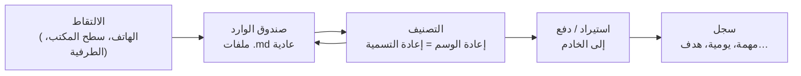

# التقط الآن وصنّف لاحقًا

الأفكار تصل أسرع مما تستطيع ترتيبها. بُني نبراس بحيث **لا يكلّف الالتقاط شيئًا**
و**يمكن تأجيل تحديد ماهية ما التقطته**.

## 1. الالتقاط { #1-capture }

اكتب سطرًا وأرسله. تُكتب الملاحظة فورًا كملف في مجلد ملاحظاتك بالنوع والأولوية والفئة
الافتراضية لديك. لا شبكة، ولا خادم، ولا نافذة حوار:

- **الهاتف** — مربع الإدخال السريع أسفل شاشة الملاحظات.
- **سطح المكتب** — حقل الإضافة (أو وضع الملاحظة الجانبية المصغّر، `Ctrl+L`).
- **الطرفية** — أي سطر ليس `/command`.

يمكن أن تحمل الملاحظات الملتقطة ملفات: ضعها في [المجلد المرافق](companion-folders.md) للملاحظة.

## 2. التصنيف { #2-classify }

لاحقًا — في الحافلة، أو في نهاية اليوم، أو متى شئت — مرّ على الكومة وقرّر ما هي كل
ملاحظة ملتقطة حقًا. ولأن النوع والأولوية والفئة تعيش في
[اسم الملف](filenames-and-tags.md)، فتغييرها مجرد إعادة تسمية:

- الخاطرة العابرة تبقى **ملاحظة**،
- "اتصل بالسبّاك" تصبح **مهمة**،
- الفقرة عن يومك تصبح مُدخلًا في **اليوميات**.

سطح المكتب هو أريح مكان لذلك: اختر بطاقة واضغط `Ctrl+Shift+<code>`.
والملاحظات التي تنتمي لبعضها يمكن **دمجها** في ملاحظة واحدة (`Ctrl+M` للتعليم، و`Ctrl+Shift+M` للدمج).

!!! question "لماذا التصنيف في تطبيقات الالتقاط وليس على الخادم؟"
    على الخادم، لكل نوع من السجلات جدوله الخاص وحقوله الإلزامية الخاصة، وملفاته
    تعيش في مكان خاص بالوحدة. تحويل ملاحظة إلى مهمة *هناك* يعني نسخ بيانات
    بين الجداول ونقل ملفات. أما في مجلد الملاحظات فهو حرف واحد في اسم ملف. لذا
    يجري الفرز في المنبع، حيث هو مجاني، وتصل السجلات إلى الخادم مرتّبة سلفًا.

## 3. الإرسال إلى الخادم (اختياري) { #3-send-to-the-server-optional }

هناك طريقتان تتحوّل بهما الملاحظة المصنّفة إلى سجل.

### الاستيراد من المجلد { #import-from-the-folder }

يستطيع الخادم قراءة مجلد ملاحظات على قرصه الخاص — عادةً نسخة تُحدَّث باستمرار بأداة
مزامنة ملفات (انظر [المزامنة](sync.md)). من صفحة **Import notes** (استيراد الملاحظات) في تطبيق الويب، أو زر الاستيراد في
صفحة **Local notes** (الملاحظات المحلية)، أو البادئة `+` في الطرفية، تتحوّل كل ملاحظة إلى سجل:

| من الملاحظة | يصبح |
|---------------|---------|
| حرف النوع | الوحدة (Tasks، Notes، Journals، Planners، Goals، Writings، Resources) |
| حرف الفئة | القسم |
| الرقم بعد `p` | الأولوية |
| الطابع الزمني | تاريخ الإنشاء |
| السطر الأول (3–120 حرفًا) | العنوان |
| بقية النص | الوصف |
| ملفات المجلد المرافق | مرفقات السجل |

بعد ذلك تنتقل الملاحظة (ومجلدها المرافق) إلى مجلد فرعي `imported/`، فلا يمكن
استيرادها مرتين أبدًا، ويُحتفظ بالأصل كنسخة للتدقيق.

!!! warning "تحذير"
    الملاحظة التي لا يطابق حرف نوعها أي وحدة تُرفض — وتُترك في مكانها. أصلح نوعها
    أولًا.

### الدفع من الهاتف { #push-from-the-phone }

على الهاتف، تعرض قائمة الملاحظة خيار **Push to Nibras** (دفع إلى نبراس). يُرسَل نوع الملاحظة وأولويتها وفئتها وعنوانها
ونصها إلى الخادم، فينشئ السجل ويعلّمه بأنه *مُعلَّم مرجعيًا* (bookmarked) ليعود
مباشرة إلى الهاتف في المزامنة التالية.

- **يعمل دون اتصال.** ينتظر الدفع في طابور على الهاتف ويُرسَل تلقائيًا عند
  عودة الشبكة.
- **تبقى الملاحظة.** لا تُنقل ولا تُحذف؛ وتُظهر أيقونة سحابة حالة *في الطابور* ثم *تم الدفع*.
- دفع الملاحظة نفسها مرة أخرى يستبدل مُدخلها في الطابور بدلًا من تكراره.
- لا تُرسل المرفقات بهذه الطريقة — استخدم الاستيراد من المجلد للملاحظات التي تحمل ملفات.

## العمل دون خادم { #working-without-a-server }

كل شيء حتى الخطوة 3 يعمل دون أي خادم على الإطلاق. مجلد الملاحظات *هو* صندوق واردك
وأرشيفك؛ ولا يصبح الخادم مفيدًا إلا حين تريد سجلات مصنّفة الأنواع وتقارير وتقويمًا.
