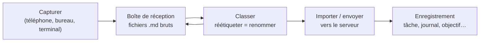

# Capturer maintenant, classer plus tard

Les idées arrivent plus vite que vous ne pouvez les ranger. Nibras est conçu pour que **capturer ne coûte rien**
et que **décider de la nature d'une capture puisse attendre**.

## 1. Capturer { #1-capture }

Tapez une ligne et envoyez-la. La note est aussitôt écrite sous forme de fichier dans votre dossier de notes, avec vos
type, priorité et catégorie par défaut. Pas de réseau, pas de serveur, pas de boîte de dialogue :

- **Téléphone** — le champ de saisie rapide en bas de l'écran des notes.
- **Bureau** — le champ d'ajout (ou le mode note latérale minimal, `Ctrl+L`).
- **Terminal** — toute ligne qui n'est pas une `/command`.

Les captures peuvent porter des fichiers : déposez-les dans le [dossier compagnon](companion-folders.md) de la note.

## 2. Classer { #2-classify }

Plus tard — dans le bus, en fin de journée, quand vous voulez — parcourez la pile et décidez ce qu'est réellement chaque
capture. Comme le type, la priorité et la catégorie se trouvent dans le
[nom du fichier](filenames-and-tags.md), les changer revient simplement à renommer :

- une pensée passagère reste une **note**,
- « appeler le plombier » devient une **tâche**,
- un paragraphe sur votre journée devient une entrée de **journal**.

Le bureau est l'endroit le plus confortable pour cela : sélectionnez une carte et appuyez sur `Ctrl+Shift+<code>`.
Les notes qui vont ensemble peuvent être **fusionnées** en une seule (`Ctrl+M` pour marquer, `Ctrl+Shift+M` pour fusionner).

!!! question "Pourquoi classer dans les applications de capture et pas sur le serveur ?"
    Sur le serveur, chaque genre d'enregistrement est une table à part avec ses propres champs obligatoires, et ses
    fichiers sont rangés à un emplacement propre au module. Transformer une note en tâche *là-bas* implique de copier des données
    entre tables et de déplacer des fichiers. Dans le dossier de notes, c'est une seule lettre dans un nom de fichier. Le
    tri se fait donc en amont, là où il est gratuit, et les enregistrements arrivent sur le serveur déjà classés.

## 3. Envoyer au serveur (facultatif) { #3-send-to-the-server-optional }

Une note classée peut devenir un enregistrement de deux façons.

### Importer depuis le dossier { #import-from-the-folder }

Le serveur peut lire un dossier de notes sur son propre disque — en général une copie tenue à jour par un
outil de synchronisation de fichiers (voir [Synchronisation](sync.md)). Depuis la page **Import notes** (Importer des notes) de l'application web, le bouton d'import de la
page **Local notes** (Notes locales), ou le préfixe `+` du terminal, chaque note devient un enregistrement :

| Depuis la note | Devient |
|---------------|---------|
| lettre du type | le module (Tâches, Notes, Journaux, Planificateurs, Objectifs, Écrits, Ressources) |
| lettre de la catégorie | le département |
| nombre `p` | la priorité |
| horodatage | la date de création |
| première ligne (3 à 120 caractères) | le titre |
| le reste du texte | la description |
| fichiers du dossier compagnon | les pièces jointes de l'enregistrement |

Ensuite, la note (et son dossier compagnon) est déplacée dans un sous-dossier `imported/` ; elle ne peut ainsi
jamais être importée deux fois et l'original est conservé comme copie de contrôle.

!!! warning "Attention"
    Une note dont la lettre de type ne correspond à aucun module est refusée — et laissée là où elle est. Corrigez d'abord
    son type.

### Envoyer depuis le téléphone { #push-from-the-phone }

Sur le téléphone, le menu d'une note propose **Envoyer vers Nibras**. Le type, la priorité, la catégorie, le titre
et le texte de la note sont envoyés au serveur, qui crée l'enregistrement et le marque comme *mis en signet* pour qu'il revienne
directement sur le téléphone à la synchronisation suivante.

- **Fonctionne hors ligne.** L'envoi attend dans une file d'attente sur le téléphone et part automatiquement au retour
  du réseau.
- **La note reste.** Elle n'est ni déplacée ni supprimée ; une icône de nuage indique *en attente*, puis *envoyée*.
- Envoyer à nouveau la même note remplace son entrée en attente au lieu de la dupliquer.
- Les pièces jointes ne sont pas envoyées de cette façon — utilisez l'import depuis le dossier pour les notes avec fichiers.

## Travailler sans serveur { #working-without-a-server }

Tout ce qui précède l'étape 3 fonctionne sans aucun serveur. Le dossier de notes *est* votre boîte de réception et vos
archives ; le serveur ne devient utile qu'une fois que vous voulez des enregistrements typés, des rapports et un calendrier.
