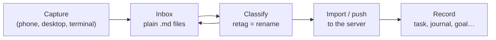

# Capture now, classify later

Ideas arrive faster than you can file them. Nibras is built so that **capturing costs nothing**
and **deciding what a capture is can wait**.

## 1. Capture

Type a line and send it. The note is written immediately as a file in your notes folder with your
default type, priority and category. No network, no server, no dialog:

- **Phone** — the quick-entry box at the bottom of the notes screen.
- **Desktop** — the add field (or the minimal side-note mode, `Ctrl+L`).
- **Terminal** — any line that isn't a `/command`.

Captures can carry files: drop them into the note's [companion folder](companion-folders.md).

## 2. Classify

Later — on the bus, at the end of the day, whenever — go through the pile and decide what each
capture really is. Because the type, priority and category live in the
[file name](filenames-and-tags.md), changing them is just a rename:

- a passing thought stays a **note**,
- "call the plumber" becomes a **task**,
- a paragraph about your day becomes a **journal** entry.

The desktop is the most comfortable place for this: select a card and press `Ctrl+Shift+<code>`.
Notes that belong together can be **merged** into one (`Ctrl+M` to mark, `Ctrl+Shift+M` to merge).

!!! question "Why classify in the capture apps and not on the server?"
    On the server every kind of record is its own table with its own required fields, and its
    files live in a module-specific place. Turning a note into a task *there* means copying data
    between tables and moving files. In the notes folder it is one letter in a file name. So
    triage happens upstream, where it is free, and records arrive on the server already sorted.

## 3. Send to the server (optional)

There are two ways a classified note becomes a record.

### Import from the folder

The server can read a notes folder on its own disk — typically a copy kept up to date with a
file-sync tool (see [Sync](sync.md)). From the web app's **Import notes** page, the import button on
the **Local notes** page, or the terminal's `+` prefix, each note becomes a record:

| From the note | Becomes |
|---------------|---------|
| type letter | the module (Tasks, Notes, Journals, Planners, Goals, Writings, Resources) |
| category letter | the department |
| `p` number | the priority |
| timestamp | the creation date |
| first line (3–120 characters) | the title |
| the rest of the text | the description |
| companion folder files | the record's attachments |

Afterwards the note (and its companion folder) moves into an `imported/` subfolder, so it can
never be imported twice and the original is kept as an audit copy.

!!! warning
    A note whose type letter matches no module is refused — and left where it is. Fix its type
    first.

### Push from the phone

On the phone, a note's menu offers **Push to Nibras**. The note's type, priority, category, title
and text are sent to the server, which creates the record and marks it *bookmarked* so it comes
straight back to the phone on the next sync.

- **Works offline.** The push waits in a queue on the phone and is sent automatically when the
  network returns.
- **The note stays.** It is not moved or deleted; a cloud icon shows *queued*, then *pushed*.
- Pushing the same note again replaces its queued entry instead of duplicating it.
- Attachments are not sent this way — use the folder import for notes with files.

## Working without a server

Everything up to step 3 works with no server at all. The notes folder *is* your inbox and your
archive; the server only becomes useful once you want typed records, reports and a calendar.
