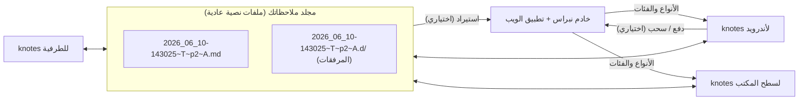

# المفاهيم

نبراس مجموعة من التطبيقات الصغيرة تجمعها بضعة أعراف بسيطة. تعلّم هذه الأعراف
وسيتصرّف كل تطبيق كما تتوقّع.

| الفكرة | في جملة واحدة |
|------|-----------------|
| [ملاحظات نصية عادية](plain-text-notes.md) | الملاحظة ملف Markdown بترميز UTF-8 في مجلد عادي — لا شيء محبوس داخل قاعدة بيانات. |
| [أسماء الملفات والوسوم](filenames-and-tags.md) | `<timestamp>~<type>~p<priority>~<category>.md` — الاسم *هو* البيانات الوصفية. |
| [التقط الآن وصنّف لاحقًا](capture-then-classify.md) | اكتب أولًا وقرّر ما هي لاحقًا؛ إعادة التسمية مجانية، لذا يجري الفرز في تطبيقات الالتقاط. |
| [المجلدات المرافقة](companion-folders.md) | الملفات المرفقة بالملاحظة تعيش بجانبها في مجلد `<name>.d/` يتبعها أينما ذهبت. |
| [العلامات المرجعية (`.tmk`)](bookmarks-tmk.md) | المواضع المعلَّمة في الصوت أو الفيديو تُحفظ في ملف نصي صغير بجانب الوسائط. |
| [المزامنة](sync.md) | تنتقل الملفات بين الأجهزة بأداة مزامنة ملفات؛ وتنتقل السجلات إلى الخادم عبر طابور انتظار. |
| [اللغات](languages.md) | واجهة بالإنجليزية والعربية والفرنسية على الهاتف؛ والنص العربي يُعرض من اليمين إلى اليسار في كل مكان. |

!!! tip "باختصار"
    كل ما تكتبه ملف تملكه. التطبيقات ما هي إلا واجهات لعرض ذلك المجلد؛ والخادم وجهة
    اختيارية، وليس شرطًا أبدًا.
