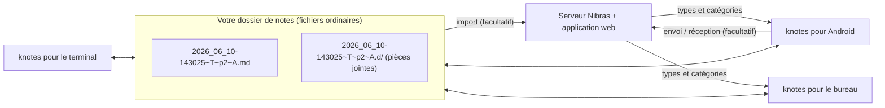

# Concepts

Nibras est un ensemble de petites applications reliées par quelques conventions simples. Apprenez ces conventions
et chaque application se comporte comme vous l'attendez.

| Idée | En une phrase |
|------|-----------------|
| [Notes en texte brut](plain-text-notes.md) | Une note est un fichier Markdown UTF-8 dans un dossier ordinaire — rien n'est enfermé dans une base de données. |
| [Noms de fichiers et étiquettes](filenames-and-tags.md) | `<timestamp>~<type>~p<priority>~<category>.md` — le nom *est* la métadonnée. |
| [Capturer maintenant, classer plus tard](capture-then-classify.md) | Écrivez d'abord, décidez ensuite de quoi il s'agit ; renommer ne coûte rien, le tri se fait donc dans les applications de capture. |
| [Dossiers compagnons](companion-folders.md) | Les fichiers joints à une note vivent à côté d'elle dans un dossier `<name>.d/` qui suit la note partout. |
| [Signets (`.tmk`)](bookmarks-tmk.md) | Les positions marquées dans un audio ou une vidéo sont conservées dans un petit fichier texte à côté du média. |
| [Synchronisation](sync.md) | Les fichiers circulent entre appareils grâce à un outil de synchronisation ; les enregistrements partent vers le serveur via une file d'attente. |
| [Langues](languages.md) | Interface en anglais, arabe et français sur le téléphone ; le texte arabe est affiché de droite à gauche partout. |

!!! tip "En bref"
    Tout ce que vous écrivez est un fichier qui vous appartient. Les applications sont des vues sur ce dossier ; le serveur est une
    destination facultative, jamais une obligation.
