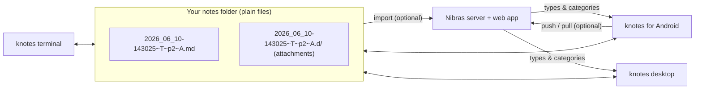

# Concepts

Nibras is a handful of small apps held together by a few simple conventions. Learn the conventions
and every app behaves the way you expect.

| Idea | In one sentence |
|------|-----------------|
| [Plain-text notes](plain-text-notes.md) | A note is a UTF-8 Markdown file in an ordinary folder — nothing is locked in a database. |
| [File names and tags](filenames-and-tags.md) | `<timestamp>~<type>~p<priority>~<category>.md` — the name *is* the metadata. |
| [Capture now, classify later](capture-then-classify.md) | Write first, decide what it is afterwards; renaming is free, so triage happens in the capture apps. |
| [Companion folders](companion-folders.md) | A note's attached files live beside it in a `<name>.d/` folder that follows the note around. |
| [Bookmarks (`.tmk`)](bookmarks-tmk.md) | Positions marked in audio or video are kept in a tiny text file next to the media. |
| [Sync](sync.md) | Files travel between devices with a file-sync tool; records travel to the server through a queue. |
| [Languages](languages.md) | English, Arabic and French interface on the phone; Arabic text is laid out right-to-left everywhere. |

!!! tip "The short version"
    Everything you write is a file you own. The apps are views over that folder; the server is an
    optional destination, never a requirement.
