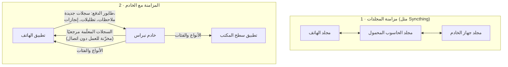

# المزامنة

لدى نبراس **نوعان مستقلان من المزامنة**، ومن المفيد التمييز بينهما:

1. **مزامنة المجلدات** — تنتقل *ملفاتك* (الملاحظات، والمرفقات، والوسائط، والعلامات المرجعية) بين الأجهزة.
   لا يقوم نبراس بذلك بنفسه؛ بل تقوم به أي أداة لمزامنة الملفات.
2. **المزامنة مع الخادم** — تنتقل *السجلات* بين الهاتف وخادم نبراس، وتنزّل تطبيقات الالتقاط
   مفردات الخادم من الأنواع والفئات.

يمكنك استخدام أيٍّ منهما، أو كليهما، أو لا شيء منهما.

## 1. مزامنة المجلدات { #1-folder-sync }

لأن كل ملاحظة ملف عادي بياناته الوصفية في اسمه، فإن إبقاء الأجهزة متوافقة هو مجرد
مسألة نسخ مطابق لمجلد. وأداة نظير إلى نظير مثل **Syncthing** خيار طبيعي — لا
حساب سحابي، وتعمل على أندرويد ولينكس وويندوز وmacOS. وأي أداة تنسخ الملفات
بأمانة تفي بالغرض.

ما الذي تجب مزامنته:

- **مجلد الملاحظات**، بما فيه [المجلدات المرافقة](companion-folders.md) `.d/` والمجلدات
  التنظيمية المخفية (كي يكون الحذف أو الدمج على جهاز ظاهرًا على الأجهزة الأخرى).
- **مجلدات الوسائط**، مع [ملفات العلامات المرجعية](bookmarks-tmk.md) `.tmk` والملفات المرافقة
  الأخرى (الترجمات، والنصوص المفرّغة).

بُنيت التطبيقات لمجلد يتغيّر من تحتها:

- تتجاهل الملفات المخفية الخاصة بأداة المزامنة (مثل `.stfolder` و`.stversions`).
- تواريخ "الإنشاء" تأتي من **اسم الملف**، لا من وقت التعديل، فلا تستطيع أداة مزامنة
  تعيد كتابة أوقات التعديل أن تعيد ترتيب ملاحظاتك.
- لا يتنازع جهازان أبدًا على اسم: ملاحظتان أُنشئتا في الثانية نفسها تحصلان على اسمين مختلفين
  (اللاحقة `-2`)، ونسخة التعارض التي تصنعها أداة المزامنة تظهر كعنصر *needs metadata* (يحتاج بيانات وصفية)
  بدلًا من أن تختفي.
- يعيد الهاتف قراءة ملف `.tmk` قبل تغييره، فلا تُكتب فوق العلامات المرجعية الواردة من سطح المكتب.
- على سطح المكتب، `Ctrl+R` يعيد قراءة المجلد لالتقاط ما وصل للتو.

!!! tip "دع الخادم يرى ملاحظاتك"
    تقرأ صفحتا **Local notes** (الملاحظات المحلية) و**Import notes** (استيراد الملاحظات) في تطبيق الويب مجلد ملاحظات على *قرص الخادم
    نفسه*. أضف جهاز الخادم إلى مزامنة مجلداتك ووجّه إعدادات تطبيق الويب إلى تلك
    النسخة، فيصبح كل ما تلتقطه من كل جهاز قابلًا للتصفّح والاستيراد من المتصفح.

## 2. المزامنة مع الخادم { #2-server-sync }

المزامنة مع الخادم **اختيارية** و**تعطي الأولوية للعمل دون اتصال**: لا يتوقّف أي تطبيق أبدًا بانتظار الشبكة،
وكل ما هو موجّه إلى الخادم ينتظر في طابور على الجهاز حتى يمكن إرساله.

### ما يبقى محليًا وما يذهب إلى الخادم { #what-stays-local-what-goes-to-the-server }

| البيانات | أين تعيش |
|------|----------------|
| الملاحظات في مجلد الملاحظات | **ملفات محلية.** لا تصل إلى الخادم إلا حين تدفعها أو تستوردها. |
| المرفقات (المجلدات المرافقة) | ملفات محلية. لا تصل إلى الخادم إلا عبر [استيراد](capture-then-classify.md#import-from-the-folder) المجلد. |
| الوسائط والعلامات المرجعية `.tmk` | ملفات محلية، تُشارك عبر مزامنة المجلدات فقط. |
| سجلات الخادم (المهام، اليوميات، الأهداف…) | على الخادم. يحتفظ الهاتف بـ **نسخة مخزّنة للعمل دون اتصال** من السجلات *المعلَّمة مرجعيًا* (إضافة إلى مُدخلات التقويم الحديثة). |
| علامات "مقروء" وقائمة النجوم الخاصة بالهاتف | على الهاتف فقط — لا تُرسل أبدًا. |

### حلقة الهاتف ↔ الخادم { #the-phone-server-loop }

**السحب.** ينزّل الهاتف سجلات الخادم *المعلَّمة مرجعيًا* من كل نوع (المهام، والمخطِّطات،
واليوميات، والأهداف، والملاحظات، والكتابات، والموارد) ويخزّنها على الجهاز. وتنزل اليوميات
والمخطِّطات أيضًا حين تقع ضمن الأسبوع الماضي أو الأسبوعين القادمين، فيكون
التقويم حول اليوم مكتملًا دائمًا. التصفّح والقراءة
والبحث في النسخة المخزّنة والتظليل والإنجاز كلها تعمل دون اتصال. ولجلب سجل غير معلَّم مرجعيًا
إلى الهاتف، ابحث في الخادم من الهاتف وعلّم النتيجة مرجعيًا؛ فتصل في المزامنة التالية.

**الدفع.** التغييرات التي تُجرى على الهاتف تدخل طابورًا أولًا وتُرسل حين يصبح الخادم
متاحًا:

- السجلات الجديدة المُنشأة بـ **Push to Nibras** (دفع إلى نبراس) من ملاحظة (انظر
  [التقط الآن وصنّف لاحقًا](capture-then-classify.md#push-from-the-phone))،
- ملاحظة تُلحق بسجل موجود،
- جملة مظلّلة في مورد،
- تعليم سجل كمُنجز،
- مُدخلات التقويم المُنشأة على الهاتف،
- إزالة سجل من العلامات المرجعية على الخادم (إن كانت النجمة مضبوطة لفعل ذلك).

السجلات المُنشأة بالدفع تُحفظ *معلَّمة مرجعيًا*، فتعود مباشرة في السحب
التالي وتظهر في كل مكان.

**متى تعمل.** كلما عادت الشبكة، وحين تنقر على التحديث، ودوريًا في
الخلفية (يسمح أندرويد بالعمل في الخلفية مرة كل 15 دقيقة تقريبًا على الأكثر).

### تنزيل المفردات { #vocabulary-download }

حين يكون خادم مُهيّأً، تنزّل تطبيقات الالتقاط مفرداته كي تتطابق الحروف في
[أسماء ملفاتك](filenames-and-tags.md) مع الخادم تمامًا:

| من الخادم | يصبح في تطبيق الالتقاط |
|-----------------|----------------------------|
| **الوحدات** المفعّلة (بترتيب فرزها) | رموز **النوع** وأسماؤه |
| **الأقسام المعلَّمة مرجعيًا** | رموز **الفئة** وأسماؤها |

- **سطح المكتب:** عند التشغيل، وبعد حفظ الإعدادات، وعند كل تبديل لمجلد الملاحظات. ويمكن لكل مجلد
  ملاحظات أن يسمّي خادمه *الخاص*، فتغذّي مجلدات مختلفة خوادم مختلفة.
- **الهاتف:** عند بدء التشغيل وعند التحديث.
- إن تعذّر الوصول إلى الخادم، أو لم يُضبط خادم، تحتفظ التطبيقات بصمت بآخر مفردات
  نُزّلت (أو المفردات الافتراضية). لا شيء ينكسر دون اتصال.

!!! info "تسجيل الدخول"
    تسجّل التطبيقات الدخول باسم المستخدم وكلمة المرور الخاصين بك في نبراس، ثم تستخدم رمز جلسة.
    اترك عنوان الخادم فارغًا للبقاء دون اتصال تمامًا.
