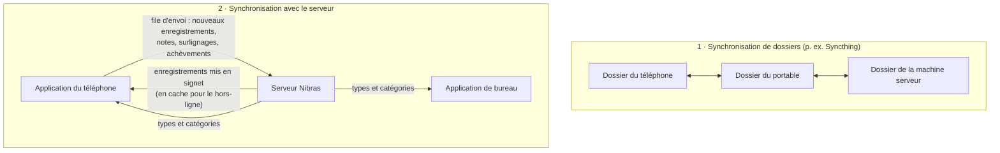

# Synchronisation

Nibras possède **deux types de synchronisation indépendants**, et il est utile de bien les distinguer :

1. **Synchronisation de dossiers** — vos *fichiers* (notes, pièces jointes, médias, signets) circulent entre appareils.
   Nibras ne s'en charge pas lui-même ; n'importe quel outil de synchronisation de fichiers le fait.
2. **Synchronisation avec le serveur** — des *enregistrements* circulent entre le téléphone et le serveur Nibras, et les
   applications de capture téléchargent le vocabulaire de types et de catégories du serveur.

Vous pouvez utiliser l'une, l'autre, les deux ou aucune.

## 1. Synchronisation de dossiers { #1-folder-sync }

Comme chaque note est un simple fichier dont les métadonnées sont dans le nom, maintenir les appareils à jour revient simplement
à refléter un dossier. Un outil pair-à-pair tel que **Syncthing** convient naturellement — pas de
compte cloud, et il fonctionne sous Android, Linux, Windows et macOS. Tout outil qui copie fidèlement les fichiers
fera l'affaire.

Ce qu'il faut synchroniser :

- **Le dossier de notes**, y compris les [dossiers compagnons](companion-folders.md) `.d/` et les
  dossiers d'intendance cachés (pour qu'une suppression ou une fusion sur un appareil soit visible sur les autres).
- **Les dossiers de médias**, avec leurs [fichiers de signets](bookmarks-tmk.md) `.tmk` et autres
  fichiers annexes (sous-titres, transcriptions).

Les applications sont conçues pour un dossier qui change sous leurs pieds :

- Elles ignorent les fichiers cachés propres à l'outil de synchronisation (comme `.stfolder` et `.stversions`).
- Les dates de « création » viennent du **nom du fichier**, pas de la date de modification ; un outil de synchronisation qui
  réécrit les dates de modification ne peut donc pas réordonner vos notes.
- Deux appareils ne se disputent jamais un nom : deux notes créées dans la même seconde reçoivent des noms distincts
  (suffixe `-2`), et une copie de conflit créée par l'outil de synchronisation apparaît comme élément *needs metadata* (métadonnées requises)
  au lieu de disparaître.
- Le téléphone relit un fichier `.tmk` avant de le modifier ; les signets arrivés depuis le bureau
  ne sont donc pas écrasés.
- Sur le bureau, `Ctrl+R` relit le dossier pour prendre en compte ce qui vient d'arriver.

!!! tip "Laissez le serveur voir vos notes"
    Les pages **Local notes** (Notes locales) et **Import notes** (Importer des notes) de l'application web lisent un dossier de notes sur le *propre disque
    du serveur*. Ajoutez la machine serveur à votre synchronisation de dossiers et faites pointer les paramètres de l'application web vers cette
    copie : chaque capture de chaque appareil devient consultable et importable depuis le navigateur.

## 2. Synchronisation avec le serveur { #2-server-sync }

La synchronisation avec le serveur est **facultative** et **pensée d'abord pour le hors-ligne** : aucune application ne se bloque jamais sur le réseau, et
tout ce qui est destiné au serveur attend dans une file d'attente sur l'appareil jusqu'à pouvoir être envoyé.

### Ce qui reste local, ce qui va au serveur { #what-stays-local-what-goes-to-the-server }

| Données | Où elles vivent |
|------|----------------|
| Notes du dossier de notes | **Fichiers locaux.** Elles n'atteignent le serveur que lorsque vous les envoyez ou les importez. |
| Pièces jointes (dossiers compagnons) | Fichiers locaux. N'atteignent le serveur que par un [import](capture-then-classify.md#import-from-the-folder) de dossier. |
| Médias et signets `.tmk` | Fichiers locaux, partagés uniquement par synchronisation de dossiers. |
| Enregistrements du serveur (tâches, journaux, objectifs…) | Sur le serveur. Le téléphone garde un **cache hors ligne** de ceux qui sont *mis en signet* (plus les entrées récentes du calendrier). |
| Marques « lu » et liste d'étoiles privée du téléphone | Sur le téléphone uniquement — jamais envoyées. |

### La boucle téléphone ↔ serveur { #the-phone-server-loop }

**Réception.** Le téléphone télécharge les enregistrements *mis en signet* du serveur pour chaque type (tâches, planificateurs,
journaux, objectifs, notes, écrits, ressources) et les met en cache sur l'appareil. Les journaux et
planificateurs sont aussi téléchargés lorsqu'ils tombent dans la semaine écoulée ou les deux semaines à venir ; le
calendrier autour d'aujourd'hui est donc toujours complet. Parcourir, lire,
chercher dans le cache, surligner et marquer comme terminé fonctionnent tous hors ligne. Pour faire venir sur le téléphone un enregistrement
non mis en signet, cherchez-le sur le serveur depuis le téléphone et mettez le résultat en signet ; il arrive à la synchronisation suivante.

**Envoi.** Les modifications faites sur le téléphone passent d'abord par une file d'attente et sont envoyées lorsque le serveur est
joignable :

- les nouveaux enregistrements créés avec **Envoyer vers Nibras** depuis une note (voir
  [Capturer maintenant, classer plus tard](capture-then-classify.md#push-from-the-phone)),
- une note ajoutée à un enregistrement existant,
- une phrase surlignée dans une ressource,
- le fait de marquer un enregistrement comme terminé,
- les entrées de calendrier créées sur le téléphone,
- le retrait d'un enregistrement des signets du serveur (si l'étoile est réglée pour cela).

Les enregistrements créés par un envoi sont enregistrés comme *mis en signet* ; ils redescendent donc directement à la
réception suivante et apparaissent partout.

**Quand elle s'exécute.** Chaque fois que le réseau revient, lorsque vous touchez actualiser, et périodiquement en
arrière-plan (Android autorise un travail en arrière-plan au plus toutes les 15 minutes environ).

### Téléchargement du vocabulaire { #vocabulary-download }

Lorsqu'un serveur est configuré, les applications de capture téléchargent son vocabulaire pour que les lettres de vos
[noms de fichiers](filenames-and-tags.md) correspondent exactement à celles du serveur :

| Depuis le serveur | Devient dans l'application de capture |
|-----------------|----------------------------|
| les **modules** activés (dans leur ordre de tri) | les codes et noms de **type** |
| les **départements mis en signet** | les codes et noms de **catégorie** |

- **Bureau :** au lancement, après l'enregistrement des paramètres, et à chaque changement de dossier de notes. Chaque dossier de
  notes peut désigner son *propre* serveur ; différents dossiers peuvent donc alimenter différents serveurs.
- **Téléphone :** au démarrage et à l'actualisation.
- Si le serveur est injoignable, ou si aucun serveur n'est défini, les applications conservent silencieusement le dernier vocabulaire
  téléchargé (ou celui par défaut). Rien ne casse hors ligne.

!!! info "Connexion"
    Les applications se connectent avec votre nom d'utilisateur et votre mot de passe Nibras, puis utilisent un jeton de session.
    Laissez l'adresse du serveur vide pour rester entièrement hors ligne.
