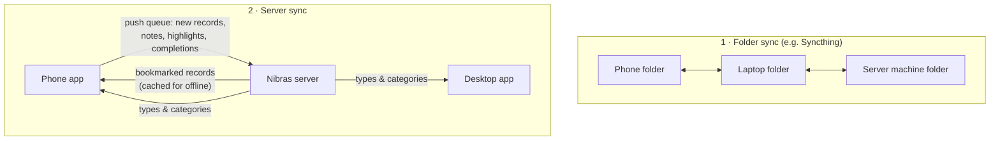

# Sync

Nibras has **two independent kinds of sync**, and it helps to keep them apart:

1. **Folder sync** — your *files* (notes, attachments, media, bookmarks) travel between devices.
   Nibras doesn't do this itself; any file-sync tool does it.
2. **Server sync** — *records* travel between the phone and the Nibras server, and the capture
   apps download the server's vocabulary of types and categories.

You can use either, both, or neither.

## 1. Folder sync

Because every note is a plain file with its metadata in the name, keeping devices in step is just
a matter of mirroring a folder. A peer-to-peer tool such as **Syncthing** is a natural fit — no
cloud account, and it runs on Android, Linux, Windows and macOS. Any tool that copies files
faithfully will do.

What to sync:

- **The notes folder**, including the `.d/` [companion folders](companion-folders.md) and the
  hidden housekeeping folders (so a deletion or merge on one device is visible on the others).
- **Media folders**, together with their `.tmk` [bookmark files](bookmarks-tmk.md) and other
  sidecars (subtitles, transcripts).

The apps are built for a folder that changes under them:

- They ignore a sync tool's own hidden files (such as `.stfolder` and `.stversions`).
- "Created" dates come from the **file name**, not the modification time, so a sync tool that
  rewrites modification times can't reorder your notes.
- Two devices never fight over a name: two notes made in the same second get distinct names
  (`-2` suffix), and a conflict copy made by the sync tool shows up as a *needs metadata* item
  rather than vanishing.
- The phone re-reads a `.tmk` file before changing it, so bookmarks synced in from the desktop
  aren't overwritten.
- On the desktop, `Ctrl+R` re-reads the folder to pick up what just arrived.

!!! tip "Let the server see your notes"
    The web app's **Local notes** and **Import notes** pages read a notes folder on the *server's
    own disk*. Add the server machine to your folder sync and point the web app's settings at that
    copy, and every capture from every device becomes browsable and importable from the browser.

## 2. Server sync

The server sync is **optional** and **offline-first**: no app ever blocks on the network, and
anything meant for the server waits in a queue on the device until it can be sent.

### What stays local, what goes to the server

| Data | Where it lives |
|------|----------------|
| Notes in the notes folder | **Local files.** They reach the server only when you push or import them. |
| Attachments (companion folders) | Local files. Reach the server only through a folder [import](capture-then-classify.md#import-from-the-folder). |
| Media and `.tmk` bookmarks | Local files, shared by folder sync only. |
| Server records (tasks, journals, goals…) | On the server. The phone keeps an **offline cache** of the *bookmarked* ones (plus recent calendar entries). |
| "Read" marks and the phone's private star list | On the phone only — never sent. |

### The phone ↔ server loop

**Pull.** The phone downloads the server's *bookmarked* records of each type (tasks, planners,
journals, goals, notes, writings, resources) and caches them on the device. Journals and
planners also come down when they fall within the past week or the next two weeks, so the
calendar around today is always complete. Browsing, reading,
searching the cache, highlighting and completing all work offline. To bring an un-bookmarked record
to the phone, search the server from the phone and bookmark the result; it arrives on the next sync.

**Push.** Changes made on the phone go into a queue first and are sent when the server is
reachable:

- new records created with **Push to Nibras** from a note (see
  [Capture now, classify later](capture-then-classify.md#push-from-the-phone)),
- a note appended to an existing record,
- a highlighted sentence in a resource,
- marking a record complete,
- calendar entries created on the phone,
- taking a record off the server's bookmarks (if the star is set to do that).

Records created by a push are saved as *bookmarked*, so they come straight back down on the next
pull and appear everywhere.

**When it runs.** Whenever the network comes back, when you tap refresh, and periodically in the
background (Android allows background work at most every 15 minutes or so).

### Vocabulary download

When a server is configured, the capture apps download its vocabulary so the letters in your
[file names](filenames-and-tags.md) line up with the server exactly:

| From the server | Becomes in the capture app |
|-----------------|----------------------------|
| enabled **modules** (in their sort order) | the **type** codes and names |
| **bookmarked departments** | the **category** codes and names |

- **Desktop:** on launch, after saving settings, and on every switch of notes folder. Each notes
  folder can name its *own* server, so different folders can feed different servers.
- **Phone:** at start-up and on refresh.
- If the server can't be reached, or no server is set, the apps silently keep the last downloaded
  (or default) vocabulary. Nothing breaks offline.

!!! info "Signing in"
    The apps sign in with your Nibras username and password and then use a session token.
    Leave the server address blank to stay fully offline.
